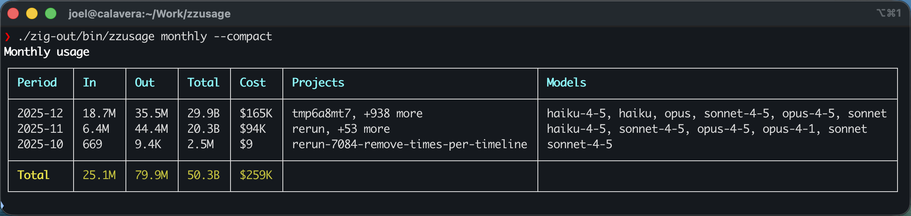

# zzusage

Fast, lightweight Claude Code usage analyzer written in Zig.

Daily usage with per-model breakdown:


Monthly usage summary:



## Features

- Parses Claude Code JSONL logs from `~/.claude/projects/` and `~/.config/claude/projects/`
- Aggregates usage by day, week, month, or session
- Calculates costs per model (including cache creation/read tokens)
- Table output with ANSI colors
- JSON output for scripting
- Parallel file processing for speed

## Performance

Compared to the [Rust implementation](https://github.com/jlowin/ccusage-rs):

| Metric | zzusage (Zig) | ccusage (Rust) |
|--------|---------------|----------------|
| Binary size | 466 KB | 4.3 MB |
| Runtime | 0.6s | 1.8s |

**9x smaller, 3x faster.**

## Build

Requires Zig 0.15+.

```bash
zig build                    # debug build
zig build -Doptimize=ReleaseFast   # release build
```

## Usage

```bash
# Daily usage (default)
zzusage daily

# Weekly/monthly aggregation
zzusage weekly
zzusage monthly

# Per-session breakdown
zzusage sessions

# Compact statusline output
zzusage statusline

# JSON output
zzusage daily --json

# Custom data directory
zzusage --data-dir /path/to/claude daily

# Timezone offset
zzusage --timezone +09:00 daily
```

## Commands

| Command | Description |
|---------|-------------|
| `daily` | Daily usage breakdown (default) |
| `weekly` | Weekly usage breakdown |
| `monthly` | Monthly usage breakdown |
| `sessions` | Per-session usage |
| `statusline` | One-line summary for shell prompts |
| `help` | Show help |

## Options

| Option | Description |
|--------|-------------|
| `--data-dir <path>` | Data directory (repeatable) |
| `--json` | JSON output |
| `--compact` | Compact table format |
| `--breakdown` | Show model breakdowns |
| `--order asc\|desc` | Sort order |
| `--timezone +HH:MM` | Timezone offset |

## License

MIT
