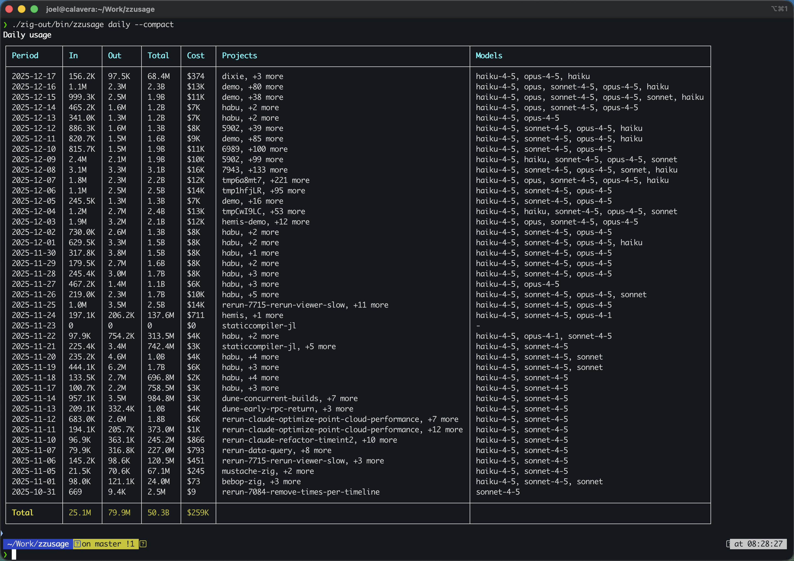

# zzusage

A small local Claude Code usage analyzer written in Habu. It scans JSONL files
under `~/.claude/projects/` and `~/.config/claude/projects/`, groups token use
and estimated cost, and prints colored tables or JSON. It makes no HTTP or API
requests. The original Zig implementation remains on the
[`zig` branch](https://github.com/joelreymont/zzusage/tree/zig).



## Build and install

Install Habu release `c53b4d2c` at `$HOME/.local/lib/habu/c53b4d2c`, or set
`HABU_ROOT` to a release directory containing `bin/hb` and `tools/hb-build.f`.
The measured compiler binary has SHA-256
`ccf0798dd4e11a3ea4308386704bd09a5f183750d18b802b9b2d9c28d6af2b96`.
The recorded build and sizes below are for macOS arm64; other targets have not
been measured here.

```sh
sh build.sh
mkdir -p "$HOME/.local/bin"
install -m 755 bin/zzusage "$HOME/.local/bin/zzusage"
```

`build.sh` writes the executable to `bin/zzusage` and keeps compiler cache and
temporary files in `.build/`. Both directories are ignored by version control.
Run `bin/zzusage --help` before installing if you prefer to keep it in the
checkout. The help banner retains the original “(Zig)” text for byte-for-byte
CLI compatibility.

## Usage

```sh
zzusage                         # daily table (default)
zzusage monthly                 # monthly table
zzusage sessions --json         # per-session JSON
zzusage statusline              # one-line status
zzusage daily --data-dir /path/to/claude
zzusage daily --timezone +09:00 --compact --breakdown
```

| Command | Output |
|---|---|
| `daily` | Daily totals; also the default |
| `monthly` | Monthly totals |
| `sessions` | Per-session totals |
| `statusline` | One-line summary |
| `weekly`, `blocks` | Daily output, matching the original implementation |
| `help`, `--help`, `-h` | Usage text |

`--data-dir PATH` is repeatable. Without it, zzusage searches the two default
Claude project directories under `HOME`. `--json` emits JSON, `--compact`
uses compact tables, `--breakdown` shows per-model details, and
`--timezone +HH:MM` (or `-HH:MM`) adjusts date grouping. `--order asc|desc`
consumes its argument but does not change sorting, as in the original CLI.
The compiled pricing table follows the pinned Zig source; it is not a live
statement of provider billing rates.

## Verification and size

The full differential runner creates synthetic Claude logs and sets a separate
`HOME` for every child process. It compares exit status, stdout bytes, stderr
bytes, and input integrity. With Zig 0.17.0 available, run from the repository
root:

```sh
sh benchmark/build-zig.sh
sh build.sh
python3 test.py benchmark/bin/zzusage-zig-full-small bin/zzusage
```

To repeat the smallest Zig comparison on macOS, run
`sh benchmark/build-zig-smallest.sh`, then pass
`benchmark/bin/zzusage-zig-smallest` as the first test argument. Results from
new runs go to `.build/test-results/`; set `ZZUSAGE_TEST_OUTPUT_DIR` to choose
another output directory. The saved 100-case runs and parity ledger are in
[benchmark/evidence.md](benchmark/evidence.md) and
[full-parity.md](full-parity.md).

| macOS arm64 executable | File bytes | Saved differential result |
|---|---:|---:|
| Habu AOT, release `c53b4d2c` | 115,836 | 100/100 versus each Zig build |
| Zig 0.17.0, stripped `-O small` | 277,864 | 100/100 |
| Zig 0.17.0, smallest measured configuration | 236,480 | 100/100 |

The Habu executable is 51.0% smaller than the smallest measured Zig binary.
These are on-disk Mach-O sizes, not memory use or speed measurements. The
original Zig scanner uses multiple workers at ten or more files, so row order
and the first project attached to a shared session ID can vary between runs.
Habu scans serially. The 99 byte comparisons use deterministic fixtures; the
concurrent-append case checks initial-event retention without requiring an
equal append count. The suite never normalizes otherwise deterministic output.

MIT licensed; see [LICENSE](LICENSE).
